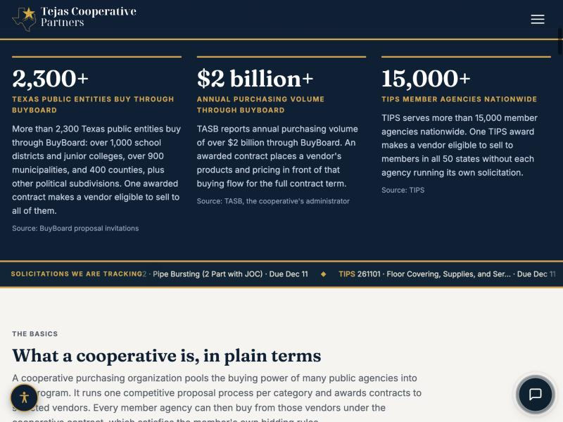
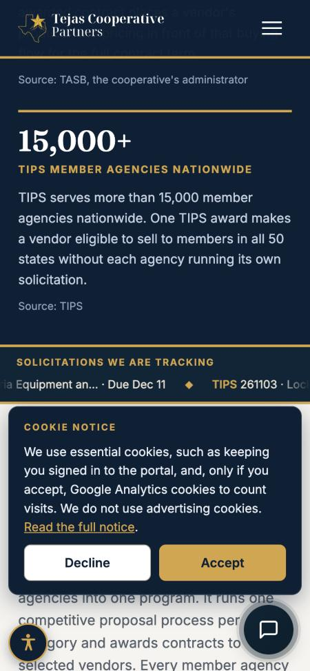

# Website solicitation ticker: report

Part A (portal feed, tejascooperative-main commit ae28210) is live. Part B (this repo) adds the band under the homepage stats band.

## How it works
- `src/ticker.js`: the Worker fetches the portal feed server-side (edge-cached 1 hour), drops items whose due date has passed, and injects the band after `section.stats-band` with HTMLRewriter. Any failure, empty list, or `generated_at` older than 48 hours returns the static homepage untouched (no band).
- Homepage responses drop ETag/Last-Modified and send `Cache-Control: no-cache`, otherwise a browser revalidates against the static file's ETag and gets a stale 304 (found and fixed during testing).
- `js/ticker.js` sets the scroll duration from the rendered width; `styles.css` holds the band styles.
- Items are not links. The duplicated list is `aria-hidden`; the band carries the required assistive label.

## 1. Live endpoint (https://portal.tejascooperative.com/api/public/solicitation-ticker)
15 items returned; no TEST record among them (TEST-TIPS-1 is excluded). First 3 shown:
```json
{
 "generated_at": "2026-11-09T15:41:27.073Z",
 "items": [
  {
   "cooperative": "TIPS",
   "number": "261104",
   "title": "Commercial Cafeteria Equipment and Furniture",
   "due_at": "2026-12-11T21:00:00.000Z"
  },
  {
   "cooperative": "TIPS",
   "number": "261103",
   "title": "Lockers (2 Part with JOC)",
   "due_at": "2026-12-11T21:00:00.000Z"
  },
  {
   "cooperative": "TIPS",
   "number": "261102",
   "title": "Pipe Bursting (2 Part with JOC)",
   "due_at": "2026-12-11T21:00:00.000Z"
  }
 ]
}
```

## 2. Desktop, mid-scroll


## 3. 375px
Label on its own line above the ticker; no horizontal page overflow.


## 4. Reduced motion
The built-in browser has no media emulation, so the stylesheet's own `prefers-reduced-motion` rules were applied unconditionally in the page: animation `none`, second copy hidden, `overflow-x:auto`, scrollable, and scrolling to the end reaches the last item ("BuyBoard 832-27 · Trade Services (Electrical) · Due Nov 12"). Not tested with a real OS-level setting.

## 5. Stale / empty / failing feed
`loadTicker()` run with a stubbed `fetch`:
| Case | Result |
|---|---|
| fresh feed | band |
| generated_at 72h old | no band |
| empty items | no band |
| fetch non-200 / throws | no band |
| only an expired item | no band |
| expired + valid item | band with the valid item only; a 2027 due date renders "Due Dec 14, 2027" |

The Worker returns the unmodified asset whenever `loadTicker()` is null; that path was not separately exercised in wrangler.

## 6. Scroll duration
Rendered list width 6,926 px. At the ~48 px/s target that is 144 s, so the 90 s cap applies: one full pass is **90 s (about 77 px/s)**. The brief's 60-90 s window and 40-55 px/s speed cannot both hold with 15 long titles; I kept the 90 s limit. Shortening the list (e.g. 10 items) or a longer cap would bring it into the speed range. Decision for the partner.
